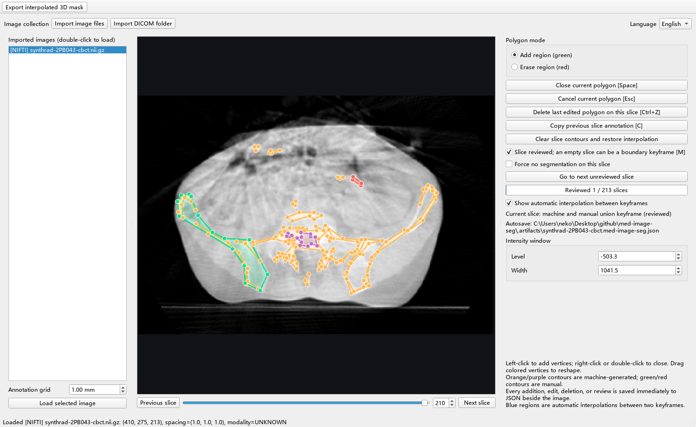

# med-image-seg

`med-image-seg` is a standalone, programmable multi-polygon annotation tool for medical images. It supports DICOM series, NIfTI, and `.ubd.npz` volumes.

The GUI is bilingual. English is the default, and users can switch between English and Chinese at runtime without reloading the image.

## Screenshot



The example shows a real pelvic CBCT with machine-generated contours in orange and purple, plus manual corrections in green and red on the same slice. The anonymized image is case `2PB043` from the [SynthRAD2023 dataset](https://doi.org/10.5281/zenodo.7260705), released under [CC BY-NC 4.0](https://creativecommons.org/licenses/by-nc/4.0/).

## Installation and launch

Python 3.12 or later is required.

```powershell
uv sync --frozen
uv run med-image-seg
```

Launching without arguments opens an empty image collection. Use **Import image files** to select one or more NIfTI, UBD, or DICOM files, or use **Import DICOM folder** for a series directory.

The CLI can provide the initial image collection. Inputs are deduplicated, and the first item is loaded automatically:

```powershell
uv run med-image-seg `
  --image "D:\dicom-series" `
  --image "D:\images\pelvis.nii.gz" `
  --image "D:\images\knee.ubd.npz" `
  --spacing 0.8
```

Positional image paths remain supported. When `--image PATH` opens a single image, the application checks the corresponding JSON location listed below. If found, it validates the source fingerprint and volume geometry before displaying the existing machine and manual contours.

To inspect a result generated by `cbct-bone`:

```powershell
uv run med-image-seg --image "D:\images\scan.nii.gz"
```

Start directly in Chinese with `--language zh`; `--language en` is the default:

```powershell
uv run med-image-seg --language zh --image "D:\images\scan.nii.gz"
```

## Annotation file locations

Autosaved annotations are always stored beside the source image:

| Image type | Annotation JSON | NIfTI mask | UBD mask |
| --- | --- | --- | --- |
| DICOM directory or a DICOM file inside it | `<DICOM directory>/.med-image-seg.json` | `<DICOM directory>/med-image-seg-mask.nii.gz` | `<DICOM directory>/med-image-seg-mask.ubd.npz` |
| `scan.nii` / `scan.nii.gz` | `scan.med-image-seg.json` | `scan.med-image-seg-mask.nii.gz` | `scan.med-image-seg-mask.ubd.npz` |
| `scan.ubd.npz` | `scan.med-image-seg.json` | `scan.med-image-seg-mask.nii.gz` | `scan.med-image-seg-mask.ubd.npz` |

The JSON does not store source paths or DICOM identity fields. It contains only the content fingerprint, resampled geometry, contours, and review state. Every polygon addition, vertex drag, deletion, copy, clear, or review action is saved immediately with atomic replacement. A rolling `.json.bak` backup and a 10-second fallback autosave are also maintained.

When a matching annotation already exists, its saved isotropic grid spacing takes
precedence over the current **Annotation grid** input while that image is loaded.
This keeps the resampled CT shape aligned with the stored polygon coordinates;
new images without annotations continue to use the value selected in the input.

### Multiple annotation files

The **Annotation number** integer control at the top of the right panel defaults
to **0** and accepts any nonnegative integer, including values beyond a 32-bit
spin box's range. Use the arrows, or type a number and press Enter/leave the field
to switch. Typing a multi-digit number does not load each intermediate number.

- Number **0** retains the original `scan.med-image-seg.json` path and always
  preserves the existing empty-project save behavior.
- Number **n >= 1** uses `scan.med-image-seg-<n>.json` in the same directory.
  DICOM directories use `.med-image-seg-<n>.json`.
- Switching closes and saves a draft with at least three vertices, saves the
  previous project, and opens the selected project without reloading the image.
  Drafts with fewer than three vertices cannot form a polygon and are discarded
  only after a successful switch.
  A missing numbered project starts empty, not as a copy of number 0. The current
  slice, window/level, and observation intersection are preserved. The selected
  number is retained when another image is loaded.
- Numbered projects save immediately after polygon and interpolation-boundary
  changes, using the same atomic replacement and backup mechanism as number 0.
  When there are **no stored polygons on any slice**, the numbered JSON, `.bak`,
  `.tmp`, and `.bak.tmp` are removed. Review, empty-keyframe, or forced-empty
  flags alone do not keep a numbered file; those flags are therefore lost when
  leaving an empty numbered project. A forced-empty slice with saved polygons,
  or an erase-only polygon, still counts as having polygons and keeps the file.
- Save, deletion, or target-validation failures leave the current project active
  and restore the displayed number. The annotation number is locked in read-only
  observation mode; return to Add or Erase before selecting another number.

The JSON export action exports the selected number and follows its empty-file
policy. All three export actions open a Save As dialog to choose the output
filename and directory. The existing filenames are suggestions, not fixed output
locations; exporting does not change the annotation's autosave path.

## GUI controls

- Imported image names of at most 10 characters, including extensions, display
  as `[FORMAT] parent-folder/filename` to distinguish short names such as `CT.nii`.
  Longer filenames and DICOM series labels keep their existing display format.
  Hovering over an entry still shows its full path.
- **Unload imported image**, below **Load selected image** in the left panel,
  saves and closes the currently open image, clears all three views, and removes
  that image from the imported list without deleting its original files. It
  removes the open image even if another list row is selected, and does not
  automatically open a remaining image. With no image open or while an operation
  is busy, the button is disabled. A failed annotation save cancels unloading.
  Images can be imported again later; external-mask preview is cleared without
  writing annotation JSON during preview.
- Loading and resampling run on a background thread. A modal estimated-percentage progress indicator is visible and the main GUI is disabled while loading.
- Left-click adds vertices. Right-click, double-click, or `Space` closes a polygon.
- While a polygon is closing, the interface and shortcuts are disabled and a waiting cursor is shown until the annotation update, JSON save, and view refresh finish. The previous enabled states are restored even if an error occurs; input received during the operation is discarded rather than replayed afterward.
- Drag a colored vertex to reshape an existing polygon.
- `Ctrl+Z` or **Delete last edited polygon on this slice** removes the polygon most recently added or vertex-edited on the current slice.
- `C` copies the previous slice annotation; `M` marks the current slice as reviewed.
- **Prev labeled slice** and **Next labeled slice**, below the ordinary slice
  buttons, jump to the nearest earlier/later slice with stored polygons in the
  currently selected annotation project. Interpolation-only slices and empty
  review/keyframe slices are skipped; stored polygons still count on forced-empty
  slices. Navigation does not wrap. A modal message appears when no matching
  slice exists in that direction. The buttons also work in observation mode.
- **Force no segmentation on this slice** keeps the output slice empty and suppresses blue interpolation. Saved contours remain intact and reappear when the option is cleared. Adding a new contour also clears the forced-empty state.
- Empty slices between two keyframes are interpolated dynamically with signed distance fields and displayed as translucent blue regions.
- A read-only coverage bar below the slice slider highlights slices whose final mask is nonempty, including machine/manual contours and interpolation. Empty and forced-empty slices remain gray, so coverage can contain multiple separate intervals. Each slice is aligned to the native slider handle position, including its end margins; hiding the interpolation preview does not change coverage. Coverage is recalculated after annotation changes, not on every slice navigation or window/level adjustment.
- Machine add/erase contours use orange/purple; manual add/erase contours use green/red. Machine and manual regions on the same slice are processed independently and then combined by union, so both contribute to the final mask.
- `E` or the `.nii.gz` toolbar action opens Save As and exports a 3D NIfTI mask including interpolated slices to the chosen path.
- The adjacent `.ubd.npz` toolbar action opens Save As and exports the same interpolated 3D mask in UBD format, preserving the L/P/S voxel array and isotropic spacing. UBD does not store the physical origin or direction.
- The `.med-image-seg.json` toolbar action opens Save As and writes the current annotation project to the chosen file. It uses the same JSON format, atomic replacement, and rolling backup as autosave. The original autosave location remains unchanged. The JSON stores contours and review state rather than a rasterized mask; interpolated slices are reconstructed when needed.
- Canceling any Save As dialog leaves files and project state unchanged. Missing format suffixes are added automatically; existing `.json` names, including numbered annotation names, are preserved. Replacing an existing file requires confirmation.

NIfTI masks are first written to an ASCII-only temporary path, then copied to the selected destination and atomically replaced. This supports Unicode output paths on Windows without exposing existing masks to partial writes. Temporary files are cleaned up after both successful and failed exports.

## Estimated progress and operation profiling

Window initialization, image loading/resampling, external-mask loading,
polygon closure, and mask Save As operations show estimated progress using
`fake-process-estimation`.
Progress dialogs refresh every 100 ms while background work runs, display
elapsed and expected durations, and support both English and Chinese. The
percentage is explicitly labeled as an estimate, not a measurement of completed
voxels or bytes. It stays below 100%
until the real operation succeeds, including when an operation exceeds its
expected duration; errors never report successful completion. Initialization of
the Qt window remains on the GUI thread, and the startup dialog does not cover
Python's earlier package imports.

Expected duration is calibrated independently for each operation from its latest
20 successful samples. Before history is available, window initialization uses a
3-second initial estimate, image loading uses 30 seconds, external-mask loading
uses 10 seconds, polygon closure uses 2 seconds, and mask exports use 10 seconds.
NIfTI and UBD exports maintain separate estimates. Failure durations are
recorded but are not used for calibration. Each operation retains up to 128
samples.

Closing a polygon with Space, the close button, right-click, or double-click
shows progress for the complete add/save/refresh operation. Polygon updates,
JSON writes, and mask-coverage calculation run sequentially in background tasks
while the GUI thread continues to paint and update the percentage. Qt graphics
remain on the GUI thread. The editor stays locked until the complete operation
finishes, and callers still wait for its result before switching images, modes,
or annotation files. Failed saves retain unsaved changes and never report 100%.

After choosing a destination for a `.nii.gz` or `.ubd.npz` mask, Save As shows
progress covering pending annotation saves, interpolated 3D mask generation,
compression, and writing the selected file. These data operations run in
background tasks while the GUI remains locked against editing and duplicate
exports. Successful completion or failure restores the previous UI state,
including read-only observation mode. Canceling the file chooser starts no
progress or background work. Export formats, Unicode-path handling, and the
original annotation autosave path are unchanged.

Profiling also records image reading, external-mask processing, JSON saves,
mask exports, and busy mode transitions. Outside the workflows described above,
recording a duration does not itself move an operation to a background thread
or add a progress dialog.

History is stored separately from image and annotation files in a local SQLite
database:

- Windows: `%LOCALAPPDATA%\med-image-seg\profiling.sqlite3`.
- macOS: `~/Library/Application Support/med-image-seg/profiling.sqlite3`.
- Linux: `$XDG_STATE_HOME/med-image-seg/profiling.sqlite3`, or
  `~/.local/state/med-image-seg/profiling.sqlite3` when the variable is unset.
- Set `MED_IMAGE_SEG_PROFILE_PATH` to use a different database file.

The `operation_samples` table contains `operation`, `elapsed_seconds`, `success`,
and `finished_at` (UTC), plus an internal sample ID. Operation names include
`startup.window`, `volume.load.nifti`, `volume.read`, `external-mask.load`,
`external-mask.read`, `polygon.close`, `annotations.save`, `mask.export.nifti`,
`mask.export.ubd`, `ui.mask.export.nifti`, and `ui.mask.export.ubd`. End-to-end
loading/export durations and worker durations are separate measurements, not
additive phases. No image paths, patient identifiers,
voxel data, or polygon coordinates are stored. Missing, damaged, locked, or
unwritable profiling files fall back to initial estimates without blocking image
operations or changing annotation formats. Deleting the database resets the
learned timings.

For example, inspect successful-operation durations with a SQLite client:

```sql
SELECT operation, COUNT(*) AS samples, AVG(elapsed_seconds) AS mean_seconds,
       MAX(elapsed_seconds) AS slowest_seconds
FROM operation_samples
WHERE success = 1
GROUP BY operation;
```

## Read-only orthogonal observation

Select **Observe (read-only)** in Polygon mode to keep the LP view in place and
open nonmodal PS and SL companion windows. These windows cannot be closed
independently; selecting Add or Erase hides them and restores editing. A draft
with at least three vertices is closed and saved before entering observation;
a draft with fewer vertices is discarded because it cannot form a polygon.

The three views share a single L/P/S voxel intersection. Click any image to move
that intersection and update the other two slice positions, or use the slice
controls. Indices start at zero. LP displays horizontal L and vertical P; PS
displays horizontal P and vertical S; SL displays horizontal S and vertical L.
The directions are also labeled in the PS and SL windows.

LP is cyan, PS is magenta, and SL is yellow. Each center marker has its own
plane's color; a reference line uses the color of the plane it represents.
LP preserves visible control points without allowing edits. PS and SL show blue
sections of the same complete interpolated mask used for export, including
manual contours, erasures, and forced-empty slices. The mask is computed once
when entering observation and reused while navigating. All polygon editing,
review, and forced-empty controls and shortcuts are disabled; navigation,
contrast, zoom, and export remain available.

## External mask preview

Use **Load external mask** / **Unload external mask**, below the window/level
controls, to inspect an existing `.nii`, `.nii.gz`, or `.ubd.npz` mask alongside
the loaded image. Load is available at startup; an image must be loaded before
choosing a mask. Unload becomes available only after a successful mask load.

- Loading first closes and saves any valid polygon draft and enters read-only
  observation mode, then opens the file chooser. Reading, alignment, and coverage
  calculation run on a background thread with a modal progress indicator. The
  main window, companion windows, and shortcuts are disabled until completion.
- LP, PS, and SL show only the external mask in translucent pale red, with linked
  crosshairs. Stored polygons, control points, and their interpolation are hidden.
  All nonzero mask labels are shown as foreground; an all-zero mask is valid.
  The slider-aligned coverage bar turns green only on nonempty external-mask
  slices, including disconnected intervals; all other slices stay gray.
- NIfTI masks are aligned using their origin, spacing, and direction, then
  resampled onto the loaded image's L/P/S grid with nearest-neighbor sampling.
  Areas outside the mask volume are empty; masks with no physical overlap are
  rejected. Unicode file paths are supported through ASCII-only temporary I/O.
- UBD masks use `body_data` in L/P/S order and the isotropic `mmpd` spacing. UBD
  stores no origin or direction, so its field of view must match the image to
  within one voxel, and the lower voxel-support edges are assumed to coincide.
  Use NIfTI when the mask has a different physical origin, orientation, or crop.
- While a mask is loaded, the current JSON project stays in memory unchanged:
  editing, annotation-number switching, autosave, export, image switching, and
  loading another mask are disabled. Slice navigation, crosshairs, contrast,
  zoom, and language selection remain available.
- Unloading restores the original annotation number, slice, intersection,
  editing/observation mode, interpolation visibility, and JSON coverage without
  reloading the JSON. Canceling the chooser or failing to load a mask also
  restores this state; failed loads display an error message.

## Python API

Launch with no initial images:

```python
from med_image_seg.Concrete.Application.Startup import C_ApplicationFactory

app = C_ApplicationFactory().from_paths([], spacing_mm=0.8)
app.run()
```

Launch with an initial collection and a Chinese interface:

```python
from med_image_seg.Concrete.Application.Startup import C_ApplicationFactory

app = C_ApplicationFactory().from_paths(
    ["D:/dicom-series", "D:/images/pelvis.nii.gz"],
    spacing_mm=0.8,
    language="zh",
)
app.add_image("D:/images/knee.nii.gz")
app.run()
```

The window language can also be changed programmatically without restarting:

```python
from PySide6.QtWidgets import QApplication
from med_image_seg.Concrete.Presentation.Window import C_Qt_AnnotationMainWindow

qt_app = QApplication.instance() or QApplication([])
window = C_Qt_AnnotationMainWindow(language="en")
window.set_language("zh")
```

The data model, interpolation, and exporter can be used independently:

```python
from med_image_seg.Concrete.Application.Projects import (
    C_AnnotationExporter,
    C_ProjectFactory,
)
from med_image_seg.Concrete.Domain.Annotations import C_PolygonAnnotation
from med_image_seg.Concrete.Storage.Volumes import (
    C_ImageSourceFactory,
    C_MedicalVolumeReader,
)

source = C_ImageSourceFactory().from_path("D:/images/pelvis.nii.gz")
volume = C_MedicalVolumeReader(0.8).read(source.getPath())
project = C_ProjectFactory().create(
    image_id=source.getSourceId(),
    source_fingerprint=source.getFingerprint(),
    volume=volume,
)
project.add_polygon(
    10,
    C_PolygonAnnotation(points=((20, 20), (80, 20), (50, 90))),
)
project.save(source.getAnnotationPath())
C_AnnotationExporter().export(project, volume, source.getMaskPath())
C_AnnotationExporter().export(project, volume, source.getUbdMaskPath())
```

Factories return `I_` interfaces, and callers use explicit getters rather than
properties. Concrete implementations are constructed at application composition
boundaries. Import paths follow the `Abstract` / `Concrete` package split; the
CLI, annotation JSON schema, mask formats, and runtime GUI behavior are unchanged.

## Architecture and collection contracts

- `med_image_seg/Abstract` contains framework-independent `I_` interfaces,
  `T_` generic interfaces, and `E_` enums. `Concrete` contains final `C_`
  implementations; Qt adapters use `C_Qt_` names.
- Writable interfaces extend their read-only counterparts. There are no
  `@property` accessors, module-level service instances, or global helper functions.
- Collections expose counts, indexed/keyed queries, and iterators, not internal
  lists or dictionaries. For example, an image collection has `getSource(index)`
  and `findByFingerprint(fingerprint)`. Canvas queries use `getDraftPoint(index)`,
  `getPolygonItem(index)`, `getPolygonPoint(polygon_index, vertex_index)`, and
  `getHandle(index)`, with separate count methods.
- Polygon coordinates use `I_PointList` and `I_Point2D`; record fields use
  `I_RecordFieldList`. Constructors may accept raw containers, but public reads
  expose typed interfaces or individual values. JSON serialization still writes
  the original coordinate arrays and field names.
- The three fixed planes use `I_ObservationPlaneSet.getLP()`, `getPS()`, and
  `getSL()`, rather than a string-keyed dictionary.
- Generic parameters are declared inline with `TypeVar` and `Generic`; no
  Python 3.12-only generic syntax is used. NumPy arrays are an explicitly allowed
  numeric boundary type. Other third-party types stay in concrete adapters.
- `Tests` and `Docs` use the same interface/implementation structure. Each type
  has one file, and each package contains at most seven Python files.
- Chinese class and method comments describe responsibilities, constraints, or
  observable behavior. Avoid stock phrases that merely repeat a method name;
  architecture tests check comment presence and reject known filler templates.
- Compatibility fixtures in `Tests/Fixtures/Annotations/Golden.json` record
  twelve pre-refactor JSON payloads, full mask hashes, and mask-presence intervals.

## Development checks

```powershell
uv run pytest
uv run pyright
uv run ruff check .
uv run ruff format --check .
uv build
```
